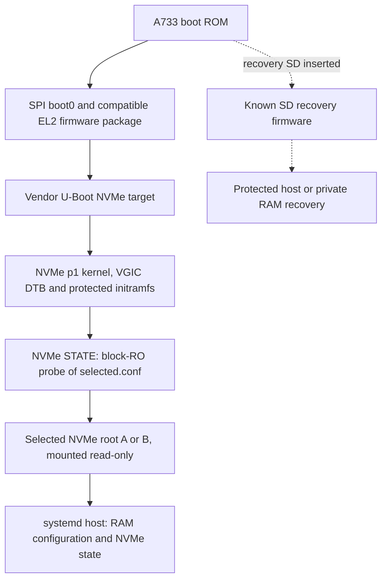
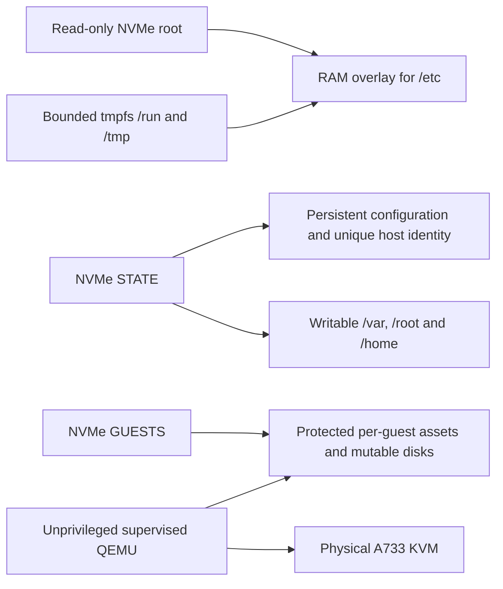

# Architecture

The target is **Orange Pi 4 Pro only**, using mandatory SPI/NVMe boot and
recovery SD. The `manual-beta` profile retains standard Linux/KVM/QEMU and working
manual management, shared admission and recovery, with automatic guest dispatch
disabled. [Scope](beta-scope.md) defines current promises and [status](implementation-status.md)
records actual acceptance. The concrete layout below describes the recorded unit;
other identical units need unique identity and a fresh target plan.

## Boot chain and recovery

The current route starts in SPI and reads Linux boot files from NVMe p1.
SD is physically removed. Cold/warm host boots and actual KVM execution pass.
The original protected SD remains available as a recovery card through the
ROM's documented SMHC0-first normal boot order.

The [protected initramfs](../configs/host-init) resolves STATE by UUID, validates
the selector and matching root marker, and refuses incompatible combinations.
Its initial STATE probe enforces block read-only protection before `ro,noload`
mounting. Normal host handoff subsequently mounts STATE writable, where journal
replay is allowed. These compatibility checks are not a cryptographic secure-boot
chain. The [firmware write audit](sd-firmware-write-policy.md) records opaque and
conditional firmware limits; retain applicable existing comparisons and serial observations; do not start a
new SD-write campaign for a documentation change.

[SPI programming and SD-removed operation](spi-sd-boot-20261111.md) now have
physical evidence. Vendor U-Boot writes its 2 KiB calibration area on startup;
boot0 and the firmware package remain unchanged in the measured snapshots.
A current backup and reviewed metadata-aware plan are required for future SPI
writes. Ordinary host root updates stay on NVMe. Explicit SD maintenance remains
available for the retained recovery card.

## Storage and mutable state

The nominal 250 GB drive actually has **256060514304 bytes**. The selected GPT
uses 512-byte logical sectors and these byte offsets and lengths:

| Partition | Offset | Length | Role |
| --- | ---: | ---: | --- |
| p1 BOOT | 1048576 | 536870912 | Prepared matched Linux boot files for NVMe firmware loading |
| p2 ROOT-A | 537919488 | 4294967296 | Immutable host A, selected by factory distribution |
| p3 ROOT-B | 4832886784 | 4294967296 | Compatible inactive host or rollback root |
| p4 STATE | 9127854080 | 8589934592 | Identity, management configuration, selector and persistent host files |
| p5 GUESTS | 17717788672 | 238342373376 | Guest assets, writable disks and checkpoint history |

The front reservation is 1048576 bytes and the tail reservation is 352256 bytes,
including backup GPT space. The SD bootstrap image is 268435456 bytes and fits
the measured **1977614336-byte** SU02G card. The installer checks exact physical
identity and capacity; a partition component is never a whole-drive image.

The p5 mountpoint `/run/a733-guests` is a RAM directory, but the mounted
filesystem and its contents reside on NVMe. Guest accounts and service units are
recreated explicitly in RAM after reboot; [activation](guest-activation.md) and
[operations](guest-operations.md) describe the steps. No disk swap is configured.
The selected host uses unique same-board identity restoration before its first
boot; factory distribution hashes describe inputs before that operation.

## Management, guests and maintenance

Management uses wired DHCP, key-only SSH and automatic NTP. This installation
accepts both supplied administration keys from any host/subnet, as requested.
Guest QEMU identities have no effective capabilities and use NoNewPrivileges.
The launcher requires `-accel kvm -cpu host` and host GIC support, with no
software-emulation fallback. Actual guest execution is recorded separately from
KVM API probes. See [physical KVM results](kvm-vgic-results-20261108.md).

[Guest networking](guest-networking.md) is restricted user networking, with an
optional explicit loopback TCP forward for the test service. A bridge or
outward NAT policy is not installed. [Checkpoints](guest-checkpoints.md) bind a
stopped, cleanly shut-down guest disk to its next launch; they are not off-device
backups. [Backup/restoration](guest-backups.md) authenticates an off-device copy.

Host updates write the inactive root and explicitly publish a compatible NVMe
selector. [Physical interruption and manual rollback](physical-host-update-rollback-20261110.md)
have passed; unattended automatic rollback is not promised. Preserve compatible
ROOT-A/ROOT-B/STATE together for [host recovery](host-state-backup.md), and retain
original dirty STATE separately before repair. [Offline selection](host-recovery.md)
and [serial access](remote-serial-control.md) cover loss of management.

Upstream interfaces: [Linux arm64 KVM](https://www.kernel.org/doc/html/latest/virt/kvm/arm/index.html),
[QEMU 7.2 Arm virt](https://gitlab.com/qemu-project/qemu/-/blob/v7.2.0/docs/system/arm/virt.rst),
and [Linux overlayfs](https://www.kernel.org/doc/html/latest/filesystems/overlayfs.html).
