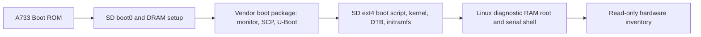

# Diagnostic SD candidate

This milestone provides a physical-console diagnostic RAM root for the Orange Pi
4 Pro **A733**. It is not the installed hypervisor. Board boot, NVMe, EL2, KVM,
firmware write behavior and recovery must be measured on the actual board.
The 2 GB figure is SD capacity; board RAM remains unknown.

## Current verified artifact

Built 2026-11-04 on the prepared Jammy host; independent review and file-only
verification passed. Physical boot has not been performed. The durable
[artifact manifest](evidence/diagnostic-20261104.json) records all hashes/sizes.

| File | Bytes | SHA-256 |
| --- | ---: | --- |
| `a733-diagnostic.img` | 268,435,456 | `b05086afaab3d2f9da6c33b8e457f3552cce2899c08824d371615008bf66d9fd` |
| `a733-diagnostic.img.gz` | 16,188,652 | `cb896f74a25de809aac4926931f9f35f091126cba365b9b9586b72e7fc57566e` |

The local workspace has both files under ignored `out/diagnostic-20261104/`.
Alternatively, retrieve the compressed file from the builder:

```sh
scp drew@build.drewnet.online:/home/drew/orange-pi-4-pro-build/artifacts/a733-diagnostic.img.gz .
printf '%s  %s\n' cb896f74a25de809aac4926931f9f35f091126cba365b9b9586b72e7fc57566e a733-diagnostic.img.gz | sha256sum -c -
gzip -dk a733-diagnostic.img.gz
printf '%s  %s\n' b05086afaab3d2f9da6c33b8e457f3552cce2899c08824d371615008bf66d9fd a733-diagnostic.img | sha256sum -c -
```

These steps write ordinary files only. Flashing still requires the exact-card
report and your authorization described below.

## Inputs and boot chain

[`diagnostic-sources.lock.json`](../configs/diagnostic-sources.lock.json) pins
the vendor build tree, Linux 6.6.98 and vendor U-Boot 2018.07 sources by commit.
The vendor branch is named `v2018.05-sun60iw2` despite its Makefile version.
[`vendor-boot-inputs.sha256`](../configs/vendor-boot-inputs.sha256) covers the
pack tools, A733 boot0, monitor, SCP and boot device-tree inputs. These opaque
firmware components are retained together with the selected vendor stack;
source availability and redistribution permissions still require a release audit.

The kernel uses the pinned vendor A733 configuration with virtualization/KVM
and `/proc/config.gz` enabled. NVMe is built in; vendor Ethernet is a module.
Userspace is Ubuntu's static ARM64 BusyBox `1:1.30.1-7ubuntu3.1`, fetched over
HTTPS with archive and executable SHA-256 pins. It supplies a local root shell,
module loading, wired DHCP and diagnostics. It starts no network listeners,
stores no credentials and mounts no disk filesystem. `/run` and `/tmp` use RAM.
This diagnostic userspace has no SSH server or QEMU; those belong to the later
host image and real guest gate.



The legacy ARM uImage header around an ARM64 kernel follows the vendor kernel's
`scripts/package/builddeb`; the vendor U-Boot's `arch/arm/lib/bootm.c` hands it
to the secure monitor. Do not replace this with a generic board boot recipe.
Sources: [pinned board family](https://github.com/orangepi-xunlong/orangepi-build/blob/a95129bf30ea11886cc35f08ebb3e69695a26656/external/config/sources/families/sun60iw2.conf),
[vendor boot script](https://github.com/orangepi-xunlong/orangepi-build/blob/a95129bf30ea11886cc35f08ebb3e69695a26656/external/config/bootscripts/boot-sun60iw2.cmd),
[kernel image packaging](https://github.com/orangepi-xunlong/linux-orangepi/blob/2ac08e8c7cdc28abbdc5c9a9dd812f887ae9c79f/scripts/package/builddeb).

## Byte layout and write policy

| Region | Start byte | Budget |
| --- | ---: | ---: |
| DOS partition table | 0 | 512 bytes |
| A733 `boot0_sdcard.fex` | 8,192 | Before boot package |
| `boot_package.fex` | 16,793,600 | Before partition 1 |
| Partition 1, ext4 | 33,554,432 | 234,881,024 bytes |
| Image end | 268,435,456 | 256 MiB total |

Partition 1 contains `/boot/boot.scr`, `uImage`, `uInitrd` and
`dtb/allwinner/sun60i-a733-orangepi-4-pro.dtb`. Its ext4 filesystem has no
journal, 64-bit or metadata-checksum features, for the old bootloader reader.
Packaging rejects boot-blob overlap, load-region overlap and oversized artifacts.
Actual card size must still be checked before any flash.

The diagnostic U-Boot stores its environment nowhere, disables `saveenv`, boot
counting, system switching, OTA boot0 handling and misc-command processing, and
restricts distro boot targets to SD (`mmc0`). Failed loads stop the script.
The remaining recovery-key misc-write path is conditional on finding a named
`misc` partition; this image has only one Linux partition and no `misc` partition.
Avoid pressing recovery/FEL keys during the baseline boot. Opaque boot0/monitor
behavior and Linux block counters still require hardware evidence. Neither
configuration review nor matching hashes proves zero writes.

The pinned old U-Boot hides `ENV_SIZE` when `ENV_IS_NOWHERE` is selected, yet its
RAM environment structure and allocator still need that size. The checked-in
`build/patches/uboot-env-nowhere-size.patch` removes only that Kconfig dependency,
retaining the vendor's 128 KiB RAM buffer. It does not enable a storage backend.
The recipe applies it to a fresh detached worktree and asserts the resulting
size and no-write settings before compilation.

## Build and verify

Use the prepared [Jammy builder](build-host-assessment.md). The recipe accepts a
dedicated workspace, verifies locked Git commits/input hashes and the recorded
package inventory, checks a file-backed loop mount and an ARM64 chroot, and
compiles sequentially with two jobs. It extracts a fresh U-Boot compiler for each
run. Generated files, downloads and logs must remain outside Git.

The package lock records the prepared host's exact installed versions; it is
not an immutable APT snapshot or a builder image digest. A future clean builder
must acquire those versions and archive their packages before reproducibility
can be claimed. Two independent clean builds and binary comparison are pending.
If a package is unavailable, report it rather than accepting another version.

Two builds with fresh U-Boot worktrees and the same kernel outputs produced
identical kernel/DTB/initramfs/configuration hashes. Their boot packages differ:
U-Boot `Makefile:1579-1586` generates a 128-byte random `sunxi_challenge` for
USB debug-key verification; its address is exposed in the firmware header.
Its random bytes and dependent checksums explain the observed U-Boot differences.
Do not normalize or replace this challenge without reviewing firmware/security
requirements. Future builds must preserve its generated source and hash before
worktree cleanup. Full bit-for-bit reproducibility is not established.

Recipe entry point (end-to-end execution evidence is tracked in status):

```sh
build/diagnostic.sh /home/drew/orange-pi-4-pro-build
```

This command passed end-to-end on the prepared host. It refuses to replace a
completed `artifacts/a733-diagnostic.img`; preserve/move the previous generated
artifact directory before another run. The recipe invokes U-Boot from its own
directory because its Makefile uses exported `PWD` for device-tree paths. Vendor
copy destinations are confined to that temporary worktree.

Host checks, which do not establish board boot:

```sh
bash tests/test-diagnostic-initramfs.sh
python3 tests/test-assemble-diagnostic.py
python3 -m unittest discover -s tests -p 'test_*.py' -v
bash -n build/*.sh configs/diagnostic-init
git diff --check
```

Actual artifact verification on the builder:

```sh
python3 scripts/verify-diagnostic.py /home/drew/orange-pi-4-pro-build/artifacts
cd /home/drew/orange-pi-4-pro-build/artifacts
sha256sum -c SHA256SUMS
```

The build produces `artifacts/a733-diagnostic.img`, its `.gz`, `SHA256SUMS`,
`artifact-manifest.json`, kernel/U-Boot configurations, input inventories and
an exact `build-recipe.tar.gz`. BusyBox source archives and component notices are
preserved beside them; see [license records](../licenses/README.md). Preserve the corresponding
`logs/` directory. Do not distribute opaque firmware as a released product until
its license/provenance audit is complete.

## Prepare the SD card without writes

On the Linux provisioning computer, connect only the intended SD adapter and
collect the following. Return the output and identify which whole device is the
2 GB card. A USB adapter's serial can describe the adapter rather than the card;
include any card identification printed on it. Do not guess from `/dev/sdX` order.

```sh
lsblk -b -o PATH,TYPE,TRAN,RM,SIZE,MODEL,SERIAL,MOUNTPOINTS
ls -l /dev/disk/by-id/
```

After selecting a candidate, read its exact byte count with
`sudo blockdev --getsize64 /dev/EXACT_WHOLE_CARD`. Reading this count is safe;
do not replace the device with an NVMe, partition or the system disk.
The image must be no larger than that count. Back up existing card contents to
another disk if needed and unmount every card partition before writing.

**Flashing is gated on your explicit authorization of that exact target after
reviewing its identity, capacity, mounts and the artifact checksum.** No erase,
physical write or SPI programming has been authorized for an unidentified device.
The device-specific write and readback commands will be supplied against that
report and the completed candidate; they have not been run yet. The diagnostic
image itself does not install to NVMe or program SPI.

## Serial console and first boot

The [vendor manual v1.4](https://fox-exe.ru/Files/OrangePi4Pro/OrangePi_4_Pro_A733_User%20Manual_v1.4.pdf),
section 2.10, printed pages 35-39 (PDF pages 42-46), specifies **3.3 V TTL** and
**115200 baud**. The printed-page-35 photograph shows a three-pin DEBUG header
beside the USB2 stack and the end of the 40-pin header. With the photograph
oriented with USB ports on the left and the 40-pin header along the bottom, its
top-to-bottom order is **GND, RXD, TXD**. Match the physical board's revision and
labels to the manual before wiring; the photo is marked V1.3.1.

With board power disconnected, connect adapter GND to board GND, adapter RX to
board TXD, and adapter TX to board RXD. Leave adapter VCC/3.3 V/5 V unconnected.
Use the board's normal power supply. Set **115200, 8 data bits, no parity, 1 stop
bit, no software or hardware flow control**. Never use an RS-232-level adapter.

Example Linux capture, substituting the identified serial adapter:

```sh
script -q -f -c 'picocom --baud 115200 --databits 8 --parity n --stopbits 1 --flow n /dev/ttyUSB0' a733-first-boot.log
```

Start capture before applying board power. Insert the authorized, verified
diagnostic SD, attach wired Ethernet if available, and power on without pressing
recovery/FEL buttons. Capture all boot0, monitor, U-Boot and Linux output. The
diagnostic init prints inventory and then a local root shell; exiting the shell
starts another. DHCP is bounded and optional; a missing network must not prevent
console access. `poweroff -f` requests kernel power-off; wait for serial output to
stop before disconnecting power.

At the shell, run these read-only checks and keep the complete output:

```sh
uname -a
cat /proc/cmdline /proc/meminfo /proc/partitions /proc/mounts
tr '\000' '\n' < /sys/firmware/devicetree/base/model
ls -l /dev/kvm /sys/class/block /sys/class/net
dmesg | grep -Ei 'kvm|hyp|el2|nvme|pcie|mmc|error|fail'
ip addr
ip route
for d in /sys/class/block/*; do
    echo "$d"
    for f in size ro stat device/model device/serial device/name device/cid; do
        if [ -r "$d/$f" ]; then echo "$f"; cat "$d/$f"; fi
    done
done
```

Return the complete serial log, externally visible board revision/RAM markings,
SSD model/serial, power supply rating and cooling details. Missing output or
failures are useful evidence; do not retry using a larger card or vendor image.
`/dev/kvm` existence is preliminary only. The release still requires an actual
KVM-only guest, NVMe boot, repeated boot/workload and write-counter/hash checks.
