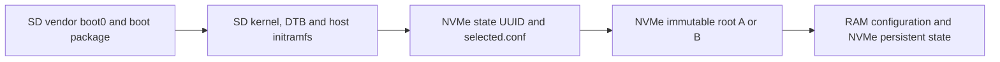

# SD bootstrap for the NVMe host

A complete 256 MiB host SD candidate has been assembled and inspected as an
ordinary file on the Ubuntu 22.04 builder. It combines the pinned diagnostic
vendor boot stack with the [NVMe host handoff](host-handoff.md). It has not
booted on the board. It is a fallback/bootstrap component, not an NVMe installer
or evidence of a working hypervisor. SPI-to-NVMe with SD removed remains the
preferred release mode.

The current candidate references fixture state UUID
`bfe5ba29-3175-47a3-a410-04b87e3de1a6`. That state contains a deleted test
credential's public key and documentation-only network settings. It is not an
operator installation. Use the [diagnostic candidate](diagnostic-image.md) for
first board boot; supply real Ethernet identity and administration public key
before preparing installation state and its matching bootstrap.

## Artifact and boot behavior

Builder output is under
`/home/drew/orange-pi-4-pro-build/host-sd-work-20261104/out/host-sd-managed-20261104-01/`.
The [manifest](evidence/host-sd-20261104.json) records input, recipe and package
versions; [independent inspection](evidence/host-sd-verify-20261104.json) records
content checks.

| File | Bytes | SHA-256 |
| --- | ---: | --- |
| `a733-host-sd.img` | 268,435,456 | `84389fabf3ab8391a452944891a75799ba13d0eda87dc695b404198c3dfbed48` |
| `a733-host-sd.img.gz` | 17,271,090 | `59f817002eb61bc8b4d55b6fcd5413d29aa65f397477b23f22aed934b53ac740` |
| `uInitrd` | 4,761,966 | `0f954b221f29507beba3965dfa6fa66bd9f5154aa6a93ef5fa8c06a8ebfea733` |

The image fits below the 2 GB card budget. Actual card capacity, identity and
explicit target authorization are still required before flashing anything.
Its DOS partition layout, raw firmware offsets and legacy ext4 features match
the [diagnostic layout](diagnostic-image.md#byte-layout-and-write-policy).
The boot partition retains the historical `A733DIAG` label; identify artifacts
by manifest/hash, not that shared label.

The host boot command preserves the vendor load addresses and legacy ARM image
wrappers around the ARM64 payload. It loads kernel, DTB and wrapped host
initramfs from SD. Linux selects the configured NVMe state and its mutable root
selector, then starts the selected immutable root. Linux does not mount SD.
Missing/incompatible state stops in serial recovery; no automatic rollback or
NVMe provisioning happens. Firmware write behavior and recovery are untested.



## Recipe and validation

On the prepared Jammy builder, from the repository:

```sh
sudo python3 build/assemble-host.py \
  /home/drew/orange-pi-4-pro-build/artifacts \
  /home/drew/orange-pi-4-pro-build/management-work-20261104/out/host-initramfs-20261104-05 \
  "$(pwd -P)/out/host-sd-managed-20261104-01"
sudo python3 tests/verify_host_sd.py \
  "$(pwd -P)/out/host-sd-managed-20261104-01" \
  /home/drew/orange-pi-4-pro-build/management-work-20261104/out/host-initramfs-20261104-05
```

These commands passed. Choose a new output name to repeat. Root is needed to
read the current private input directories; the packager itself performs no
mounts, device operations or package installation. It refuses existing outputs,
symlink paths, special files, RAM staging and outputs outside a new repository
`out/host-sd-*` directory. Failed builds retain their output/log and require a
new name for retry. Keep images on known fixed builder storage or transfer by
authenticated networking/USB, never stage on SD or RAM.

The diagnostic kernel, DTB and firmware are captured and checked against the
committed diagnostic hashes. The caller supplies a trusted host build manifest;
its compressed initramfs hash, ABI, boot inputs and current init/resolver source
records are checked. This is a trust boundary: the supplied manifest is not a
release signature. Preserve the manifest and its provenance with the artifact.
Exact selected Jammy packaging package versions/architectures are enforced from
`configs/builder-packages.lock.tsv`. The overall clean-builder image, tool
binary integrity and firmware licensing audits remain open.

Independent inspection checked the full disk hash, MBR, raw boot-blob offsets,
ext4 features, pinned kernel/DTB, legacy script and initrd header/data CRCs,
script contents, compressed distribution expansion and all 424 newc entries.
It matched the actual state UUID and init/resolver bytes to the supplied
manifest/current source. Packaging and inspection did not use physical targets.
A [clean-checkout repeat](evidence/host-sd-rebuild-20261104.json) at
`a349c8b` reproduced the raw image, gzip and wrapped initrd byte-identically,
using the cached authenticated inputs and same pinned packaging tools. The
second image also passed independent inspection. This repeats assembly only;
it is not a fresh firmware/kernel/userspace build or reproduced deployment.

Default diagnostic assembly regressions also passed after adding the optional
explicit boot-command input to the shared assembler.

The compressed fixture artifact and manifest are also available in
`/home/drew/orange-pi-4-pro-build/host-sd-artifacts-20261104/` on the builder
and under ignored local `out/host-sd-20261104/`. The transferred compressed file
was checked against the hash above. These files contain no host private keys.

## Hardware handoff still required

The [diagnostic guide](diagnostic-image.md) provides exact target identification,
authorized flashing, 3.3 V serial wiring and 115200 8N1 capture instructions.
Do not flash this fixture bootstrap as an installed host. Once real NVMe state
is installed, build its matching bootstrap, then apply the same exact-target
approval and readback procedure using that artifact's own hashes.

Return full serial logs for boot and failure paths, selected NVMe identities and
mounts, management/key verification and the separate real KVM guest results.
The [acceptance record](hardware-validation.md) also requires repeated cold/warm
boots, workload, zero SD writes, rollback, backup/restore and reproduced
deployment. None is satisfied by this file build.

Vendor protocol sources and upstream kernel packaging references are linked in
the [diagnostic boot-chain explanation](diagnostic-image.md#inputs-and-boot-chain).
