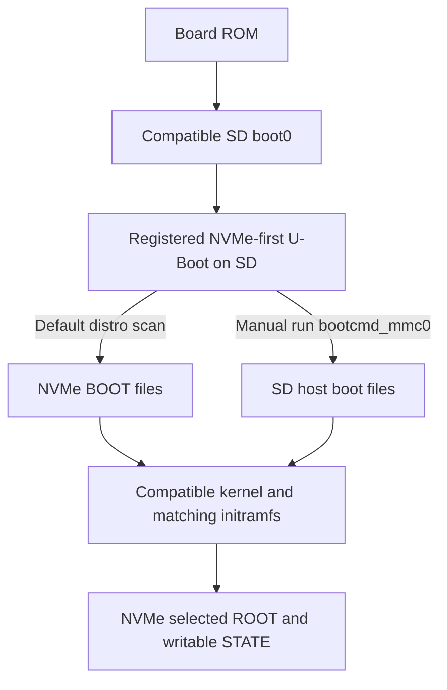

# Test NVMe-first firmware from SD before SPI programming

The [frozen construction and inspection](evidence/nvme-firmware-test-sd-20261107.json)
now produce a **256 MiB** SD image carrying the registered NVMe-first U-Boot
candidate. This provides a firmware test stage before any SPI programming.
Software construction and inspection pass; this image has not booted on the
board. It does not establish SPI boot, a working recovery route or KVM execution.

**Your next board action remains the
[existing-install repair](installed-host-repair-20261107.md).** This new test SD
is paired with production state UUID `fc8bbef6-9385-4ddb-90ba-e41eaccc035b`.
The installed NVMe uses `00fd936c-49fb-4fea-87c8-928b9c1599e0`; these do not pair.
Do not write this image over the current host SD or reinstall NVMe to fix DHCP.
No new physical flashing step is requested here.

## Boot paths and scope



The SD raw boot package is the already compiled and separately replayed
[NVMe-first candidate](uboot-nvme-candidate.md), SHA-256
`bdfe070a2c358de9dd0061b39609f604c0c12e9c25140903505f88799cc343be`.
Compatible SD boot0, kernel, DTB, module carrier and initramfs are preserved.
The SD retains `configs/host-boot.cmd` for a manual fallback. Default firmware
sets `boot_targets nvme` and runs its broader distro scan; the
[matching NVMe candidate](production-nvme-composition.md) supplies the separate
`spi-nvme-v1` script. See the
[linked search-policy evidence](evidence/nvme-firmware-search-policy-20261107.json)
for partition-1 fallback, script/extlinux paths and disabled EFI.

The fallback command and diagram describe source behavior. Physical default
boot and manual fallback remain untested. Successful SD transport would verify
this U-Boot's NVMe/Linux handoff, while ROM selection, SPI boot0, flash contents,
SD-removed boot and corruption recovery would still need separate proof.
`ENV_IS_NOWHERE`, disabled `saveenv`, skipped misc/system-switching and the
reviewed EL2 service `0x8000ff40`/SPSR `0x3c9` remain pinned. Real zero routine SD
writes still require counters, full-card hashes and firmware/workload audit.

## Reproducible source selection

`build/assemble-host.py --boot-profile nvme-first-el2-test` selects only the
registered `nvme-candidate-20261107-ram02` package. The loader authenticates the
exact registry, original candidate evidence, source/component bindings,
configuration safeguards and original compatible EL2 inputs. It accepts no
caller-supplied package pins. Baseline/default and `experimental-el2` selections
retain their existing metadata and recipes.

The [tracked adapter](../build/launch-nvme-test-sd.py) authenticates the exact
historical production-bootstrap launcher before reusing its input/source
closure, private frozen namespace, resource guards and complete SD inspection.
It changes the package/profile/recipe policy and the two explicit assembly/
inspection profile selections. The historical launcher and independently
implemented SD reader remain unchanged. No root/state image is rebuilt here.
The original baseline userspace archive supplies only locked initramfs storage
tools; production roots/state retain their time-enabled userspace profile.

The executed command, from producer commit
`2c6f08adb5c3fd0f87810fddde9bc8638954ad37`, was:

```sh
sudo python3 -I -B \
  /var/lib/a733-nvme-test-sd-project-20261107/project/build/launch-nvme-test-sd.py \
  --project /var/lib/a733-nvme-test-sd-project-20261107/project \
  --tag nvme-firmware-01 \
  --userspace /var/lib/a733-sd-replay-inputs-20261106/rootfs.tar.gz \
  --diagnostic /var/lib/a733-nvme-test-sd-inputs-20261107 \
  --busybox /var/lib/a733-sd-replay-inputs-20261106/busybox \
  --state-receipt /var/lib/a733-clean-replay-20261106/host-state-timesync-02/receipt.json \
  --state-receipt-sha256 3abeb7ba014eae05acebfd7af3b75dab7c4c58999b96d8c752163bb96a2ccd33
```

The same command with `--plan` passed first. The completed tag refuses reuse.
The diagnostic input directory contains seven individually authenticated copies:
the original diagnostic inputs with only the boot package replaced by the
registered candidate. Copy preparation verifies source identities and hashes
before publishing read-only files. All 603 tracked source records are bound to
the retained Git bundle/checkout.

## Retained outputs and validation

Builder phase:
`/var/lib/a733-clean-replay-20261106/host-bootstrap-nvme-firmware-01`.
Image outputs are under `work/project/out/host-sd-nvme-firmware-01`.

| File | Bytes | SHA-256 |
| --- | ---: | --- |
| `a733-host-sd.img` | 268,435,456 | `1db41fa64748f1fcb275f7ef0cacd5e531e0481e0b514f8f8617b0e7d1f7afdb` |
| `a733-host-sd.img.gz` | 17,271,916 | `477d63faf661ccff584e36a968dad6ff85266905419a44ebc848699582fd7dd7` |
| `uInitrd` | 4,762,428 | `71fd015c5eaab267e46d9bea5eb0a4aafa24349c2e2dbf81dad7d8a0d31b9290` |

The raw image remains on the builder; native
`out/nvme-firmware-sd-20261107` retains only compressed image, initramfs and small
proof records. Its initramfs/manifest bytes match the earlier production
bootstrap. The 256 MiB image fits the actual 1,977,614,336-byte SD.

The producer validates MBR/raw firmware placement, compatible filesystem
features, kernel/DTB, boot script/wrappers/CRCs, all 424 newc entries and complete
gzip expansion. All 842 host packages are unchanged; no mapped process, phase
mount or real device node remains. Initial budget is 4,655,638,062 bytes;
runtime minima are 21,274,603,520 free bytes and 7,275,708,416 available RAM.
Final builder free is 21,618,569,216 bytes. This SD phase uses its existing 4 GiB
recipe admission plus staging; a later full NVMe composition still requires
its separate unchanged 22 GiB guard. No guard reduction or LV growth occurred.

Privileged Ubuntu discovery passes **1,596 tests without skips or failures**.
An initial test-launch command attempted to enter the private checkout before
sudo and was refused before any tests ran; the corrected root-shell invocation
completed successfully. Independent source review also passes 43 focused
profile/adapter/historical-bootstrap cases. Full artifact-review scope and
hashes are recorded in the linked evidence. The artifact reviewer also checks
the original production gzip and proves the new raw image is byte-identical
outside the boot-package range `[16793600,18186240)`. These are software results.

## Future hardware test gate

Only after a deliberately matched NVMe deployment and management validation,
use this transport SD to capture the full serial boot. At an interrupted U-Boot
prompt, record `version` and `printenv bootcmd boot_targets bootcmd_nvme
bootcmd_mmc0`, then perform the
[read-only NVMe enumeration/file-read test](spi-boot-investigation.md#resolved-source-policy-and-remaining-candidate-work).
Capture the actual default NVMe boot and a separate manual
`run bootcmd_mmc0` boot. Neither `saveenv` nor any `sf`/erase/write command belongs
in that test. Return serial logs and installed root/state identities.

Before any SPI programming, retain the original flash backup off-device,
demonstrate recovery, independently inspect the actual backup-derived candidate
and exact erase-unit plan, identify the live target, then request the agreed
simple yes/no confirmation. Actual SD-removed cold boot, KVM guest CPU/disk/
network/persistence and all remaining [release acceptance](hardware-validation.md)
remain mandatory.
